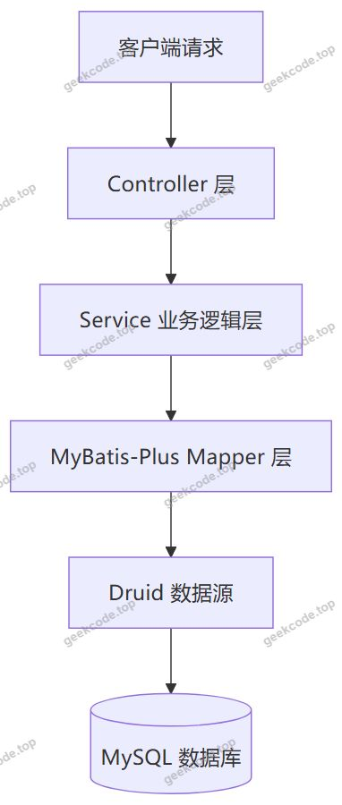
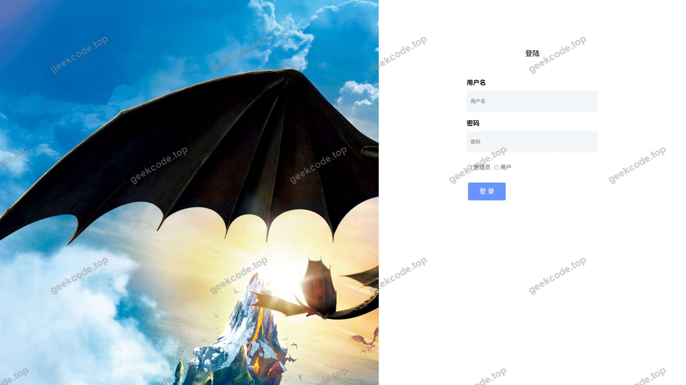
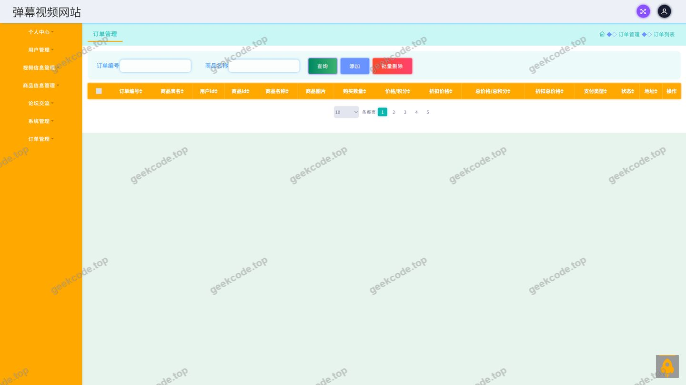
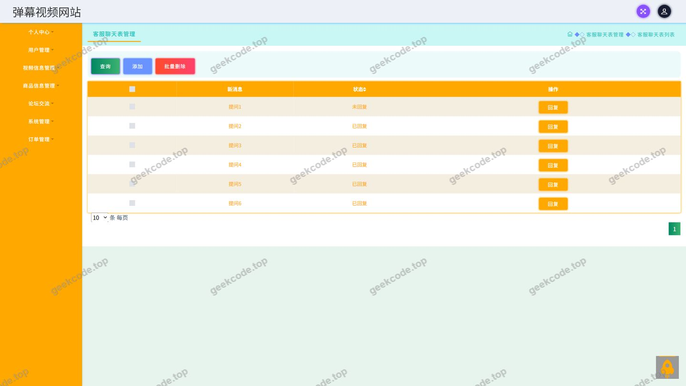
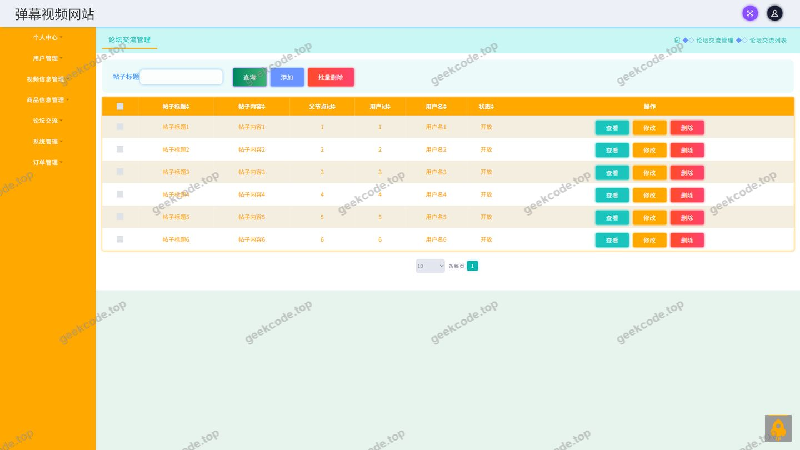
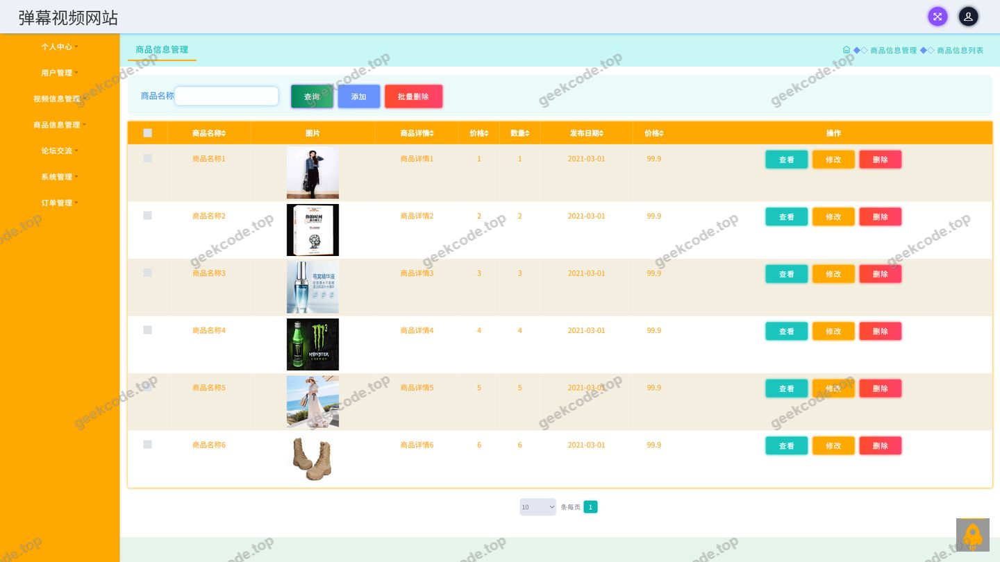
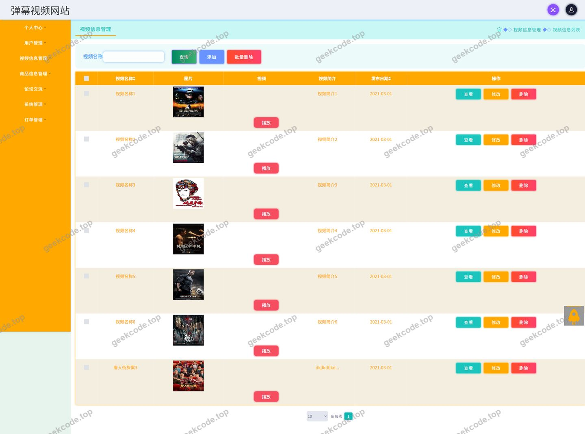
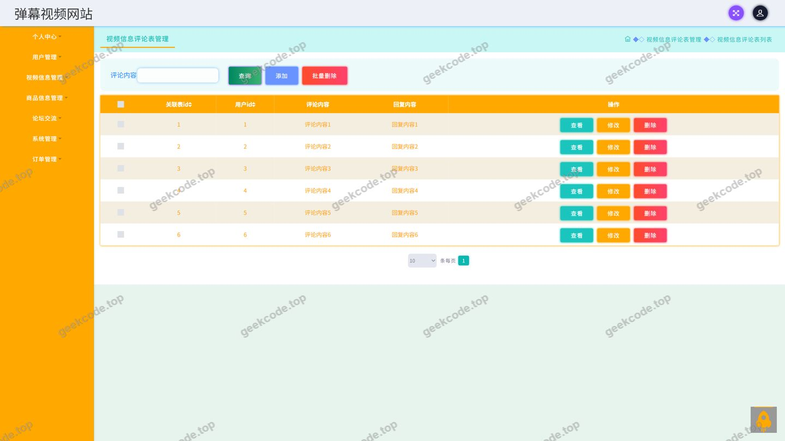
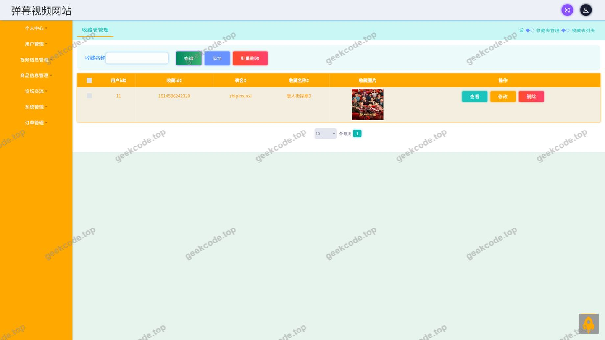
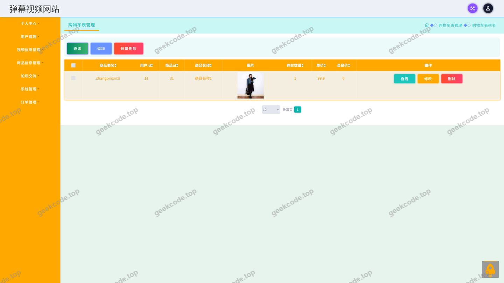

# ssm弹幕视频网站-java毕业设计

> 🎓 **计算机毕业设计 · ssm弹幕视频网站-java毕业设计**
>
> 本仓库只放**项目介绍 + 运行截图**（截图是站点带水印的原图，存在仓库 `images/` 里）。
>
> 👉 **完整可运行源码 / 数据库脚本 / 部署文档：[点我获取](https://geekcode.top/archives/ssm%E5%BC%B9%E5%B9%95%E8%A7%86%E9%A2%91%E7%BD%91%E7%AB%99-java%E6%AF%95%E4%B8%9A%E8%AE%BE%E8%AE%A1?utm_source=github)**
>
> 💬 咨询微信：**ir9372**　|　🌐 更多项目：[极客代码 geekcode.top](https://geekcode.top/?utm_source=github)
>
> 📌 项目详情页：<https://geekcode.top/archives/ssm%E5%BC%B9%E5%B9%95%E8%A7%86%E9%A2%91%E7%BD%91%E7%AB%99-java%E6%AF%95%E4%B8%9A%E8%AE%BE%E8%AE%A1?utm_source=github>

<table><td width="230" align="center"> <b>扫码加微信 ir9372</b></td><td valign="middle">📦 源码 = 项目介绍 + 全部运行截图 + 数据库 + 部署文档 👉 点上方任意截图，直接跳到 <b>极客代码 geekcode.top</b> 详情页</td></table>

---

<h1>ssm弹幕视频网站-java毕业设计</h1>
<h2>项目概述</h2>

本项目为弹幕视频网站的服务端接口工程，采用纯接口形态对外提供数据服务。系统围绕视频内容这一核心，将视频信息、商品信息与论坛信息三条业务主线整合在同一平台：用户可以浏览视频信息、查看商品信息、参与论坛交流，并对视频发表评论；在个人中心中可管理个人资料、查看自己发布的内容、维护收货地址、管理订单与收藏。平台同时提供客服咨询能力，形成从内容消费到商品交易、社区互动的完整链路。

项目适用于毕业设计答辩演示、中小型内容社区原型验证以及前后端分离架构的教学实践场景，面向需要视频内容管理、商品交易与社区互动一体化能力的使用者。技术上以 Spring 容器与 Spring MVC 构建 Web 层，MyBatis-Plus 承担持久化操作，Druid 提供数据库连接池支持，工程按接口类型拆分为视频信息、商品信息、论坛、订单、收藏、地址等独立控制器，结构清晰、职责单一。

<h2>技术架构</h2>
<h3>整体架构</h3>

项目为 pure-api 类型工程，不包含独立的前台与后台页面路由，所有能力通过控制器暴露接口，由外部客户端调用。整体采用经典的分层结构：

<h3>技术选型说明</h3>
<ul>
<li><strong>Spring 容器体系</strong>：工程依赖 spring-core、spring-beans、spring-context、spring-context-support，负责 Bean 的生命周期管理与容器上下文支持。</li>
<li><strong>Spring MVC</strong>：依赖 spring-web、spring-webmvc，承担请求映射、参数绑定与响应返回等 Web 层职责。</li>
<li><strong>Spring 事务与 AOP</strong>：通过 spring-tx 声明式管理事务，通过 spring-aop 实现横切逻辑。</li>
<li><strong>JDBC 支持</strong>：依赖 spring-jdbc 作为数据访问的基础支撑。</li>
<li><strong>MyBatis-Plus</strong>：作为持久层框架，在 MyBatis 基础上提供通用 Mapper 能力，减少单表增删改查的样板代码。</li>
<li><strong>Druid</strong>：作为数据库连接池，承担连接的创建、复用与监控职责。</li>
<li><strong>JUnit</strong>：用于单元测试。</li>
</ul>
<h3>数据库设计要点</h3>

根据控制器命名可以确认系统的核心数据对象包括：视频信息（Shipinxinxi）、商品信息（Shangpinxinxi）、视频评论（Discussshipinxinxi）、论坛交流（Forum）、订单（Orders）、购物车（Cart）、收货地址（Address）、收藏（Storeup）、客服咨询（Chat）以及用户信息。各业务对象之间存在明确的从属关系，例如订单归属于用户、评论归属于视频信息、收藏关联具体资源。

各数据表的具体字段结构、主外键约束与索引设计，根据现有信息无法确定。

<h2>功能模块</h2>
<h3>前台用户端</h3>
<ul>
<li><strong>登录</strong>：用户身份校验与登录态建立。</li>
<li><strong>视频信息</strong>：视频列表与详情浏览，是平台的核心内容模块，对应 ShipinxinxiController。</li>
<li><strong>视频信息评论</strong>：用户对视频发表评论、查看评论内容，对应 DiscussshipinxinxiController。</li>
<li><strong>商品信息</strong>：商品列表与详情浏览，对应 ShangpinxinxiController。</li>
<li><strong>购物车</strong>：商品的加购与购物车管理，对应 CartController。</li>
<li><strong>论坛交流</strong>：发布帖子、浏览论坛内容与互动，对应 ForumController。</li>
<li><strong>订单</strong>：下单与订单信息查看，对应 OrdersController。</li>
<li><strong>我的地址</strong>：收货地址的维护，对应 AddressController。</li>
<li><strong>我的收藏</strong>：对视频、商品等资源的收藏管理，对应 StoreupController。</li>
<li><strong>我的发布</strong>：查看本人发布的内容。</li>
<li><strong>个人中心</strong>：个人信息的集中管理入口。</li>
<li><strong>客服咨询</strong>：用户与客服之间的咨询会话，对应 ChatController。</li>
<li><strong>文件上传</strong>：图片等文件资源的上传处理，对应 FileController。</li>
<li><strong>通用与配置接口</strong>：公共数据获取与系统配置读取，对应 CommonController 与 ConfigController。</li>
</ul>
<h3>后台管理端</h3>

项目未配置独立的后台管理路由，管理侧的能力通过统一的接口层提供。根据截图信息，系统中存在用户管理页面，用于对用户信息进行维护；视频信息、商品信息、论坛信息、订单等业务数据同样由上述控制器统一承载。

<h2>用户角色与权限</h2>

根据现有截图与导航菜单信息，系统可确定以下角色划分：

<h3>管理员</h3>
<ul>
<li>用户管理：对平台注册用户信息进行查看与维护。</li>
<li>视频信息管理：对视频内容进行维护。</li>
<li>商品信息管理：对商品内容进行维护。</li>
<li>论坛信息管理：对论坛内容进行维护。</li>
<li>订单管理：查看与处理平台订单数据。</li>
<li>客服咨询管理：处理用户提交的咨询会话。</li>
</ul>
<h3>注册用户</h3>
<ul>
<li>视频信息：浏览视频列表与详情，发表视频评论。</li>
<li>商品信息：浏览商品列表与详情，加入购物车。</li>
<li>论坛信息：浏览与参与论坛交流。</li>
<li>个人中心：查看与维护个人信息。</li>
<li>我的发布：管理本人发布的内容。</li>
<li>我的订单：查看本人订单。</li>
<li>我的地址：维护本人收货地址。</li>
<li>我的收藏：管理本人收藏记录。</li>
<li>客服咨询：提交咨询并与客服沟通。</li>
</ul>
<h2>项目特色与创新点</h2>
<ol>
<li>
<strong>内容与交易一体化</strong>：将弹幕视频内容、商品信息与论坛社区三条业务线整合在同一套接口体系中，用户在一次登录后即可完成内容浏览、社区互动与商品交易，避免多系统割裂带来的体验断层。

</li>
<li>
<strong>业务边界清晰、控制器职责单一</strong>：工程按业务域拆分为独立控制器，视频信息、商品信息、论坛、订单、购物车、地址、收藏、客服、文件、通用、配置各司其职，便于分工开发与后续横向扩展。

</li>
<li>
<strong>纯接口架构、多端复用</strong>：项目以 pure-api 形态交付，不绑定特定前端实现，接口可同时服务于多种客户端形态，降低了前端技术选型对服务端的约束。

</li>
<li>
<strong>持久层效率优化</strong>：借助 MyBatis-Plus 的通用 Mapper 能力，将大量单表操作从手写 SQL 中解放出来，使开发重心聚焦于业务逻辑本身。

</li>
<li>
<strong>连接资源可控</strong>：引入 Druid 连接池统一管理数据库连接，为接口的并发访问提供稳定的数据访问支撑。

</li>
</ol>
<h2>部署环境</h2>
<h3>运行环境</h3>
<ul>
<li><strong>JDK</strong>：需具备 Java 运行环境，用以运行 Spring 容器与 Spring MVC 应用。具体 JDK 版本根据现有信息无法确定。</li>
<li><strong>MySQL</strong>：作为关系型数据库存储业务数据。具体版本根据现有信息无法确定。</li>
<li><strong>Maven</strong>：工程依赖 spring-core、spring-web、spring-webmvc、MyBatis-Plus、Druid、JUnit 等坐标，需通过 Maven 完成依赖解析与构建。具体版本根据现有信息无法确定。</li>
</ul>
<h3>依赖组件</h3>
<ul>
<li>Spring 核心组件：spring-core、spring-context、spring-context-support、spring-beans</li>
<li>Spring Web 组件：spring-web、spring-webmvc</li>
<li>Spring 数据与事务组件：spring-jdbc、spring-tx、spring-aop</li>
<li>持久层：MyBatis-Plus</li>
<li>连接池：Druid</li>
<li>测试框架：JUnit</li>
</ul>
<h3>启动前置条件</h3>

启动前需完成 MySQL 数据库的创建与初始化，并在工程配置中正确配置数据库连接信息（URL、用户名、密码），确保 Druid 数据源能够正常建立连接。

<h2>五、技术特性</h2>
<ul>
<li>使用 MyBatis-Plus 简化数据访问层开发</li>
</ul>
<h2>六、功能模块截图</h2>
<h3>后台管理端</h3>
<h4>页面-登录</h4>

<h4>页面-订单</h4>

<h4>页面-客服咨询</h4>

<h4>页面-论坛交流</h4>

<h4>页面-商品信息</h4>

<h4>页面-视频信息</h4>

<h4>页面-视频信息评论</h4>

<h4>页面-收藏</h4>

<h4>页面-用户</h4>

---

## 获取完整源码

| 项目 | 说明 |
| --- | --- |
| 项目名 | ssm弹幕视频网站-java毕业设计 |
| 运行截图 | 本文 10 张（站点带水印原图，仓库 `images/` 目录） |
| 完整源码 | [https://geekcode.top/archives/ssm%E5%BC%B9%E5%B9%95%E8%A7%86%E9%A2%91%E7%BD%91%E7%AB%99-java%E6%AF%95%E4%B8%9A%E8%AE%BE%E8%AE%A1?utm_source=github](https://geekcode.top/archives/ssm%E5%BC%B9%E5%B9%95%E8%A7%86%E9%A2%91%E7%BD%91%E7%AB%99-java%E6%AF%95%E4%B8%9A%E8%AE%BE%E8%AE%A1?utm_source=github) |
| 咨询微信 | **ir9372**（备注：jingpin-yuanma） |
| 更多项目 | [极客代码 geekcode.top](https://geekcode.top/?utm_source=github) |

> 需要源码、部署、改配置、跑不起来等问题，加微信 ir9372 沟通，说明项目名即可。
